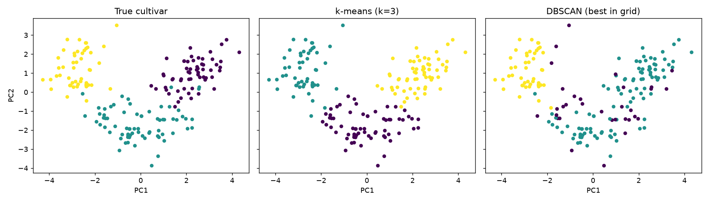
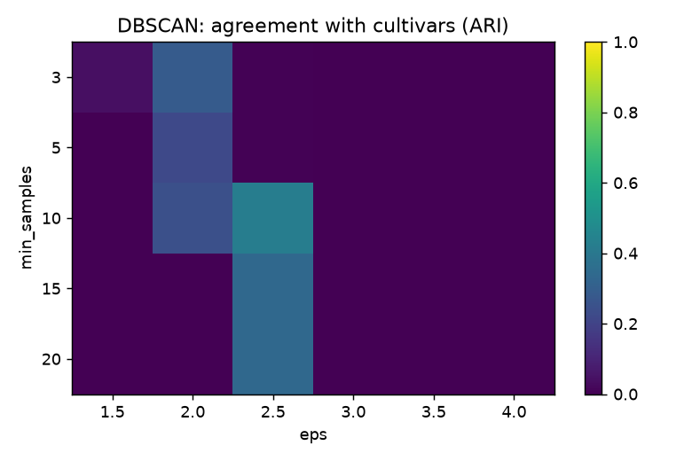
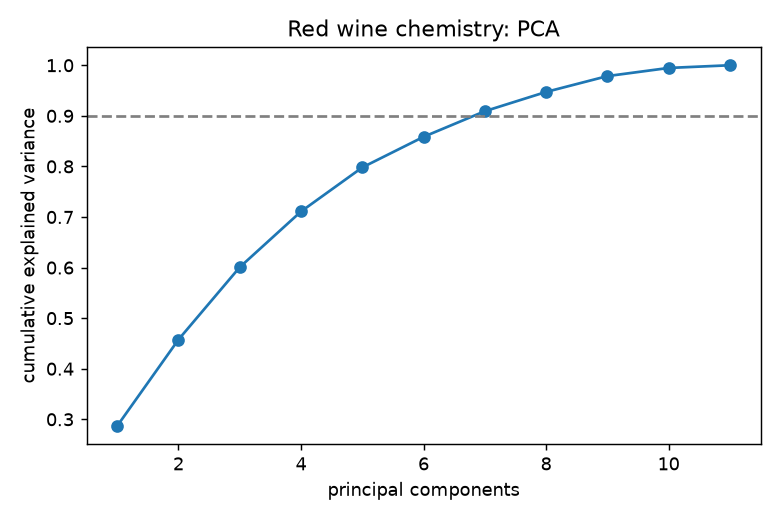

# Wine Chemistry Analysis


Two questions about what a wine's chemistry can tell you, answered with unsupervised methods and checked against ground truth.

1. **Can clustering rediscover grape cultivars from chemistry alone?** (178 Italian wines, 13 measurements, 3 cultivars)
2. **Does a wine's quality score live in its chemistry?** (1,143 red vinho verde wines, 11 measurements, quality 3-8)

**Short answers:** (1) Yes with k-means (ARI 0.90), no with DBSCAN (best ARI 0.42, and only when tuned with the answer in hand). (2) Only weakly: chemistry beats guessing the most common score by about 17 points at best, so quality is not simply a function of these 11 numbers.

## 1. Rediscovering cultivars

All features are z-scored first (proline is about 1000 times larger than hue). The cultivar label is never used for fitting, only to score the result with the adjusted Rand index (ARI: 1 is a perfect match, 0 is chance).

| Method | Clusters | Noise points | Silhouette | ARI vs cultivar |
|---|---|---|---|---|
| k-means, k = 3 | 3 | 0 | 0.285 | **0.897** |
| DBSCAN, eps from k-distance elbow, min_samples = 26 | 1 | 8 | n/a | -0.007 |
| DBSCAN, best of a 30-setting grid (picked using the labels) | 2 | 32 | 0.323 | 0.424 |



**What this shows**
- The cultivars are nearly spherical blobs in standardised space, which is exactly what k-means assumes. It recovers them with 0.90 ARI, though it is told k = 3.
- DBSCAN struggles. The three cultivars have different densities and touch each other, so a single eps either merges them (the textbook elbow rule finds one big cluster) or marks most of the data as noise. Even the best setting out of the grid, chosen by peeking at the labels, only reaches ARI 0.42 and rejects 32 wines as noise.
- Note that the highest silhouette (0.323, DBSCAN) goes with the *worse* match to the truth. Silhouette is not a safe tuning target here.



Full grid: [`results/dbscan_grid.csv`](results/dbscan_grid.csv). Only 6 of the 30 settings exceed ARI 0.2, and 6 label every wine as noise: DBSCAN is very sensitive to its parameters on this data.

## 2. Does quality live in the chemistry?

PCA on the 11 standardised measurements of red wine:

- 7 components are needed to explain 90% of the variance, and the first two explain only 46%. There is no small set of directions: the chemistry is genuinely 7-dimensional.
- PC1 is "acidity and density" (fixed acidity, citric acid, pH, density); PC2 is "sulfur dioxide" (total and free SO2).



To see whether quality is visible in those directions, a logistic regression predicts the quality score from the first *n* components (5-fold cross-validation):

| Inputs | CV accuracy |
|---|---|
| Always guess the most common score (5) | 0.423 |
| First 2 PCs | 0.514 |
| First 7 PCs | 0.584 |
| All 11 PCs | 0.592 |

Chemistry carries real signal (+17 points over guessing) but far from enough to predict taste: quality scores come from human tasters. Two PCs, which is what a typical 2D scatter plot shows, barely beat the baseline, so the usual coloured-by-quality PCA plot does not show a clean separation, and shouldn't be expected to.

Class balance: quality 3: 6, 4: 33, 5: 483, 6: 462, 7: 143, 8: 16. The extremes are too rare to say much about.

## Limitations

- Both datasets are small and come from single regions (Italy for the cultivars, northern Portugal for the red wines). Neither result is a statement about wine in general.
- DBSCAN was tuned over a limited grid (eps 1.5-4.0, min_samples 3-20); a finer search could do somewhat better, but the sensitivity is the finding.
- Quality accuracy is a simple linear baseline. Tree models would likely score higher; the aim here is to test what a low-dimensional linear view shows, not to build the best predictor.
- The PCA used for the accuracy table is fitted on all rows (the label is never used, so there is no label leakage, but a stricter pipeline would fit it inside each fold).

## Reproduce

```bash
python -m venv .venv && source .venv/bin/activate   # Windows: .venv\Scripts\activate
pip install -r requirements.txt
python run_analysis.py      # regenerates everything in results/
pytest                      # 11 tests
```

## Layout

```
wine/           data loading, clustering helpers, PCA helpers
run_analysis.py reproduces all tables and figures
tests/          unit tests
data/           wine_cultivars.csv (UCI Wine), wine_quality_red.csv (red vinho verde quality)
results/        figures and CSVs used in this README
```

## History

This repo replaces two earlier method-centred repos, `Clustering_DBSCAN` and `DimReduction_PCA`.
